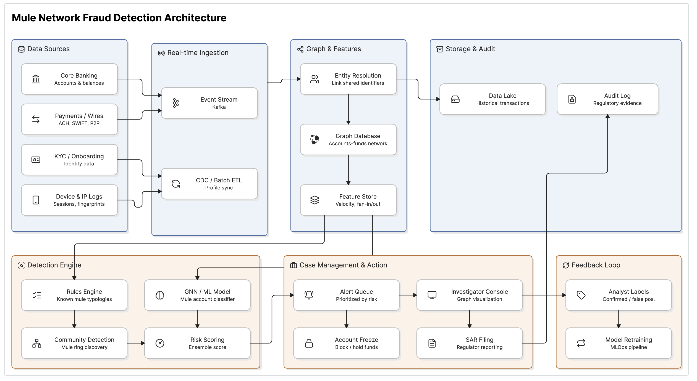

# TheOne

Most fraud losses in Nigerian banks today come from people who were talked into sending the money themselves. Their PIN, OTP and fingerprint all check out, because they really are the ones paying.

Scam money always lands somewhere first, usually in a mule account that gets paid by many strangers and empties itself within minutes. TheOne finds those accounts and the rings they form, and checks every outgoing payment before it leaves the bank: allow it, warn the sender, ask the owner to confirm, or hold it.


## Architecture



This is the architecture we're building towards. Today the repo has the detection engine, real-time payment checks, ring analysis, the analyst console, bank holds and blocks through an Open Banking Nigeria connector, and voice, iris and device step-up. Kafka, a graph database and a GNN come with bank-scale rollout. More on the code layout in [docs/ARCHITECTURE.md](docs/ARCHITECTURE.md).

## Running it

```bash
# backend
cd backend
python3 -m venv .venv && .venv/bin/pip install -r requirements.txt
curl -L -o models/3dspeaker_speech_eres2net_base_sv_zh-cn_3dspeaker_16k.onnx \
  https://github.com/k2-fsa/sherpa-onnx/releases/download/speaker-recongition-models/3dspeaker_speech_eres2net_base_sv_zh-cn_3dspeaker_16k.onnx
cp .env.example .env
.venv/bin/uvicorn app.main:app --reload --port 8000

# console, in another terminal
cd frontend
npm install
npm run dev
```

Open http://localhost:3000, press Get started, go to Mule rings and press Demo data.

Tests: `cd backend && .venv/bin/python -m pytest -q`
